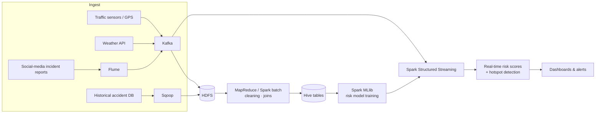

# Urban Accident Risk Analytics: Multi-Source Big Data Fusion for Predictive Urban Mobility

**A unified Big Data pipeline that fuses streaming traffic data, weather feeds, historical mobility and accident records, and social-media incident reports. It uses Kafka, Hadoop and Spark to produce real-time accident and congestion risk scores and hotspot maps for smart-city planning.**

*Course: 22AIE312 Big Data Analytics · Domain: Smart City Urban Mobility Analytics*

---

## Why This Domain

- Rapid urbanisation demands smarter traffic and mobility solutions
- Less congestion, fewer accidents and faster emergency response
- Better-informed decisions for government and city planners
- Real-time monitoring and predictive analytics for Intelligent Transportation Systems (ITS)

## Problem

Urban transport networks generate huge volumes of **heterogeneous, real-time data**: traffic sensors, GPS, weather APIs and social-media reports. Traditional systems can't process this fast enough to give timely, accurate risk predictions.

## Proposed System



### Novelty

- **Multi-source fusion:** traffic, weather, social signals and historical data together
- **Hybrid architecture:** batch and real-time workflows (Lambda style)
- **Real-time risk scoring and hotspot detection** with Spark MLlib
- **Fully integrated stack:** Kafka → Hadoop → Spark → ML → dashboards

### The 5 V's

| V | In this system |
|---|---|
| **Volume** | Years of city-wide accident and traffic records plus continuous sensor streams |
| **Velocity** | Second-level traffic and GPS events, near-real-time weather and social feeds |
| **Variety** | Structured (sensors, DB), semi-structured (JSON APIs) and unstructured (social text) |
| **Veracity** | Noisy GPS, duplicate reports and unverified social posts, handled by cleaning and cross-source validation |
| **Value** | Actionable risk alerts, hotspot maps and planning insights |

## Tech Stack

| Layer | Tools |
|---|---|
| Ingestion | Apache Kafka · Flume · Sqoop |
| Storage | HDFS · Hive |
| Batch processing | Hadoop MapReduce · Apache Spark |
| Stream processing | Spark Structured Streaming |
| Machine learning | Spark MLlib (Random Forest / GBT classifiers) |
| Visualisation | Dashboards (Folium / Plotly / Grafana) |

## Objectives

1. Design a Big Data architecture for real-time mobility analytics
2. Ingest streaming and batch data with Kafka, Flume and Sqoop
3. Preprocess large-scale data with Hadoop MapReduce and Spark
4. Build ML models that forecast congestion and accident risk
5. Visualise risk hotspots and mobility patterns on dashboards
6. Evaluate scalability, accuracy and performance

## Project Structure

```
Urban-Accident-Risk-Analytics-Big-Data/
├── docker-compose.yml           # Kafka + Zookeeper for local development
├── ingestion/
│   └── traffic_producer.py      # simulated traffic + weather events -> Kafka
├── batch/
│   └── train_risk_model.py      # Spark: clean, fuse, feature-engineer, train MLlib model
├── streaming/
│   └── realtime_risk.py         # Spark Structured Streaming: score events, detect hotspots
├── hive/
│   └── schema.sql               # Hive table definitions
└── requirements.txt
```

## Getting Started

```bash
pip install -r requirements.txt
docker compose up -d                                   # Kafka on localhost:9092

# 1. Batch: train the risk model on historical accidents (e.g. US-Accidents dataset)
spark-submit batch/train_risk_model.py --data data/accidents.csv --model models/risk_rf

# 2. Stream: publish simulated live events
python ingestion/traffic_producer.py

# 3. Score live events and print hotspots
spark-submit --packages org.apache.spark:spark-sql-kafka-0-10_2.12:3.5.1 \
    streaming/realtime_risk.py --model models/risk_rf
```

## Team

Team 12 · Amrita Vishwa Vidyapeetham, Coimbatore

- Dodla Nithya Sai
- M. Vishnu Vardhan
- P. Sreekar Reddy
- S. Beena Reddy
